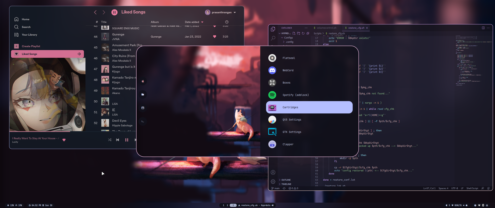
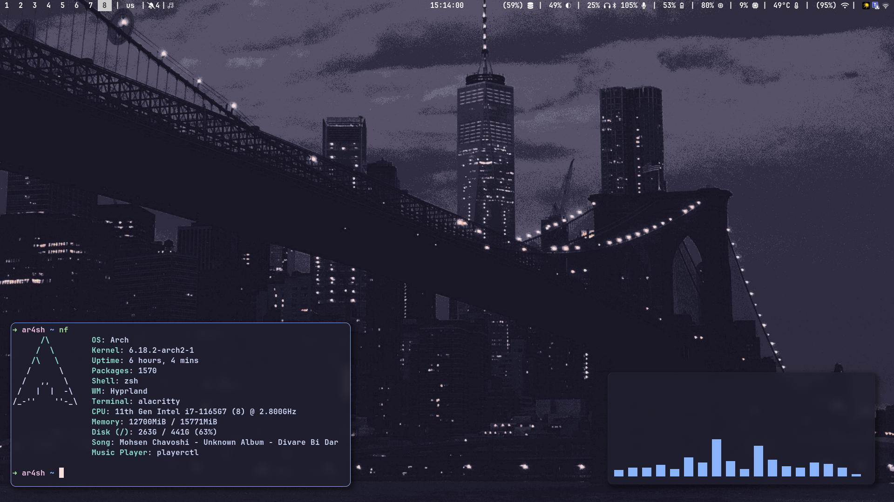

<div align="center">

# ⚡ Desktop Shell Switcher
### Live Hot-Swapping for Hyprland & Wayland Desktop Shells & Rices

[](LICENSE)
[](https://archlinux.org)
[](https://gnome.pages.gitlab.gnome.org/libadwaita/)
[](https://github.com/Dev-pradhuman/shell-switch/issues/new/choose)

<p align="center">
  <b>Switch between completely different desktop rices and shells (Caelestia, DankMaterialShell, HyDE, end-4, ML4W, Waybar, Quickshell) instantly — without logging out, restarting Hyprland, or losing your open windows.</b>
</p>

[Features](#-key-features) • [Installation](#-installation) • [Usage](#-usage) • [Supported Rices](#-supported-rices-out-of-the-box) • [Add Your Own Rice](#-creating-your-own-rice-profile) • [24h Support](#-need-help--24-hour-bug-fix-guarantee)

---

</div>

<p align="center">
  
  
</p>

---

## ✨ Key Features

- 🔄 **Live Hot-Swapping:** Change your entire desktop appearance, panels, widgets, and keybinds on the fly in `< 1 second`.
- 🛡️ **Non-Destructive Safety Backup:** Automatically preserves pre-existing configs into an `original/` profile before symlinking. On-demand snapshots with `shell-switch backup`.
- 🪟 **Session Preserved:** Your open windows, terminals, workspaces, and running apps remain completely untouched.
- 📥 **1-Click Rice Catalog:** Browse and install community rices with one command (`shell-switch get <name>`) or via the GUI "Explore Rices" tab.
- 🎨 **Modern Native GUI:** Built with Libadwaita / GTK4 with live search filtering, active daemon badges (`󰍹 Quickshell`, `󰍹 Waybar`), and keyboard shortcuts (`Ctrl+F`, `Ctrl+R`, `Esc`).
- ⚡ **Full Shell Tab Completion:** Tab auto-completion out-of-the-box for Bash, Zsh, and Fish.
- 🔗 **Smart Symlink Routing:** Dynamically swaps and manages symlinks for `~/.config/{hypr,waybar,quickshell,rofi,swaync,...}` cleanly without modifying your dotfiles repositories.
- 🚀 **Full Daemon Decoupling:** Uses session process detachment (`setsid`) so bars, daemons, and wallpapers never die unexpectedly.
- 📦 **Arch Linux PKGBUILD:** AUR-ready packaging (`makepkg -si`) for seamless package manager integration.

---

## 📸 Screenshots & Showcase

| HyDE Modular Desktop | ML4W Glass Center |
|:---:|:---:|
|  |  |

| 44 Dots Rice | DankMaterialShell M3 |
|:---:|:---:|
|  | *Quickshell M3 Panels & Control Center* |

---

## 📦 Supported Rices Out-of-the-Box

The switcher includes battle-tested adapters for popular Linux/Hyprland rice setups:

| Rice Profile | Architecture | Components |
| :--- | :--- | :--- |
| **Caelestia** | Quickshell | Dynamic colors, sliding drawers, wallpaper blur |
| **DankMaterialShell (DMS)** | Quickshell + Go daemon | Material 3 panels, dock, control center, audio visualizer |
| **HyDE Project** | Waybar + SwayNC + Rofi | Modular pill/leaf bar, Wallbash color engine, notifications |
| **end-4 (dots-hyprland)** | Quickshell `ii` suite | Material You widgets, background clocks, Fuzzel launcher |
| **ML4W Dotfiles** | Waybar (Glass) + SwayNC | Floating glass top bar, quicklinks, theme switcher |
| **44 Dots** | Waybar + SwayNC | Catppuccin Mocha minimal bar with persistent workspaces |
| **43PR Rice** | Quickshell + Hyprquickpaper | Custom top widget bar, wallpaper switcher |

---

## 🚀 Installation

### Prerequisites

Make sure you have PyGObject and Libadwaita installed:

#### Arch Linux / EndeavourOS:
```bash
sudo pacman -S --needed python-gobject gtk4 libadwaita waybar swaync git
```

#### Fedora:
```bash
sudo dnf install python3-gobject gtk4 libadwaita waybar swaync git
```

#### Ubuntu / Debian (Wayland):
```bash
sudo apt install python3-gi gir1.2-gtk-4.0 gir1.2-adw-1 waybar swaync git
```

---

### Installation Methods

#### Method 1: Quick Install (User-level)

```bash
git clone https://github.com/Dev-pradhuman/shell-switch.git
cd shell-switch
./install.sh
```

The installer configures:
1. `shell-switch` into `~/.local/bin/` (CLI)
2. `desktop-shell-app` into `~/.local/bin/` (Libadwaita GUI)
3. Application launcher icon in your app menu (`desktop-shell-switcher.desktop`)
4. Tab completions for **Bash**, **Zsh**, and **Fish**

#### Method 2: Arch Linux (PKGBUILD / AUR)

```bash
git clone https://github.com/Dev-pradhuman/shell-switch.git
cd shell-switch
makepkg -si
```

---

## ⌨️ Hyprland Keybinding

Add this to your `~/.config/hypr/hyprland.conf` (pre-configured in Caelestia keybinds!):

```hyprlang
# Open Desktop Shell Switcher (Super + Ctrl + R)
bind = SUPER CONTROL, R, exec, rice gui
bind = SUPER CONTROL, S, exec, rice gui
```

Now press `Super + Ctrl + R` anywhere to bring up the switcher!

---

## 💻 Usage

### 🖥️ Native Libadwaita GUI
Launch it from your application menu, Hyprland keybinding (`Super + Ctrl + R`), or run:
```bash
rice
# or
rice gui
# (or legacy alias: shell-switch gui)
```

- **Installed Tab**: View all your installed rices with live running bar badges (`󰍹 Quickshell` / `󰍹 Waybar`).
- **Live Search (`Ctrl+F`)**: Instant fuzzy search across all your installed profiles.
- **Explore Rices Tab**: Browse popular community rices and install them with a single click.
- **Keyboard Shortcuts**:
  - `Super + Ctrl + R` - Open Switcher GUI anywhere
  - `Ctrl + F` - Focus live search bar
  - `Ctrl + R` - Refresh profile list
  - `Esc` - Close switcher window
- **Safe Hot-Swap**: Click **"Switch to this Shell"** to swap configurations immediately without window loss.

---

### ⌨️ Command Line Interface (`rice`)

```bash
# List all installed shells and active profile
rice list

# Show the currently active shell, keybinds, and defaults
rice current

# Switch to a shell immediately (uses default Caelestia keybinds!)
rice dms
rice 44dots
rice hyde
rice ml4w
rice end4
rice caelestia

# ⌨️ Independent Keybinds Switching (Decoupled Keybinds)
rice keybinds                 # View active keybinds profile and available options
rice keybinds caelestia       # Set Caelestia keybinds across all desktop rices
rice keybinds match           # Make keybinds follow whatever UI shell is active
rice dms caelestia            # Hot-swap UI to DMS while keeping Caelestia keybinds!
rice 44dots hyde              # UI from 44dots, keybinds from HyDE

# ⚙️ Default Desktop & Keybinds Configuration
rice default                  # View default desktop and keybinds
rice set-default caelestia    # Set default shell (and its keybinds) for the system

# 🚀 Adaptive Launcher & Sidebar Dispatchers
rice launcher                 # Intelligently toggles active desktop's native launcher
rice sidebar                  # Intelligently toggles active desktop's native notification center

# Explore community rice catalog & 1-click install
rice get            # View available rice catalog
rice get hyde       # Download and install HyDE rice
rice get dms        # Download and install DankMaterialShell

# Backup and Safety Snapshots
rice backup         # Snapshot your current desktop config to a safe profile
rice backup my-rice # Snapshot to a custom profile name

# Remove an installed profile
rice remove 44dots

# Force restart the current shell
rice caelestia --force

# Clone any GitHub dotfiles repo directly as a shell
rice clone https://github.com/username/my-rice.git my-rice
```
*(Note: `shell-switch` is fully preserved as an alias for backwards compatibility!)*


---

### ⌨️ Independent Keybinds & Unified Muscle Memory

When switching between desktop rices, losing your muscle memory or having conflicting Hyprland keybinds is frustrating. **Desktop Shell Switcher decouples your visual UI shell from your Hyprland keybindings:**

- **Universal Caelestia Keybinds by Default:** By default, all installed and explored desktop rices (DankMaterialShell, 44dots, HyDE, end-4, ML4W) inherit Caelestia's comprehensive Lua keybinding system.
- **Independent Control (UI = Shell 1, Keybinds = Shell 2):** Run DankMaterialShell's modern dock and panels while retaining Caelestia's window movements, workspace cycling, and app binds (`shell-switch dms caelestia`).
- **Smart Adaptive Dispatcher:** Keys like `Super` (launcher) and `Super + N` (sidebar/notification center) dynamically adapt:
  - In **Caelestia:** opens Caelestia drawers
  - In **DankMaterialShell:** toggles DMS Spotlight and Control Center
  - In **HyDE / 44dots:** toggles Rofi and SwayNC
  - In **end-4:** toggles Fuzzel
- **Customizable Default:** Pick any shell as your baseline default with `shell-switch set-default <shell>`.


---

## 🛠️ Creating Your Own Rice Profile

Adding a new shell or dotfiles setup is as simple as creating a folder under `~/.config/desktop-shells/<profile-name>/`:

```
~/.config/desktop-shells/my-rice/
├── profile.sh      # Shell profile script (required)
└── preview.png     # Card preview banner (optional)
```

### Example `profile.sh`:

```bash
#!/usr/bin/env bash
NAME="My Custom Rice"
DESCRIPTION="Minimalist Hyprland setup with Waybar and SwayNC"
ICON="preferences-desktop-theme"

# Config folders to symlink into ~/.config/ when active
declare -A CONFIG_MAP=(
    ["hypr"]="$PROFILE_DIR/hypr"
    ["waybar"]="$PROFILE_DIR/waybar"
    ["swaync"]="$PROFILE_DIR/swaync"
)

# Startup Hook (starts your panels/daemons)
start_shell() {
    pkill -x waybar 2>/dev/null || true
    pkill -x swaync 2>/dev/null || true
    pkill -x qs 2>/dev/null || true

    sleep 0.3
    setsid waybar >/dev/null 2>&1 &
    setsid swaync >/dev/null 2>&1 &
}

# Cleanup Hook (stops panels when switching away)
stop_shell() {
    pkill -x waybar 2>/dev/null || true
    pkill -x swaync 2>/dev/null || true
}
```

---

## 🚨 Need Help? / 24-Hour Bug Fix Guarantee

> [!IMPORTANT]
> ### ⚡ 24-Hour Bug Fix Guarantee
> If you encounter **any error, crash, missing bar, or compatibility issue** with any desktop shell:
> 1. [Open a Bug Report](https://github.com/Dev-pradhuman/shell-switch/issues/new?template=bug_report.yml) with your distro and shell logs.
> 2. **We actively maintain this project and guarantee maintainer triage and a fix or workaround within 24 hours!**
> 3. Want an out-of-the-box adapter for a rice that isn't listed yet? [Submit a Rice Request](https://github.com/Dev-pradhuman/shell-switch/issues/new?template=rice_request.yml)!

---

## 🤝 Contributing

Contributions are very welcome! If you have a popular rice or dotfile configuration you'd like an out-of-the-box profile adapter for, feel free to open a Pull Request.

---

## 📄 License

This project is open source and available under the [MIT License](LICENSE).

---

<div align="center">
  <b>Built with ❤️ for the Linux ricing community by <a href="https://github.com/Dev-pradhuman">Dev-pradhuman</a></b>
</div>
